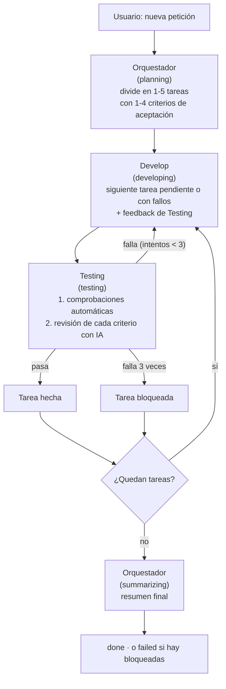

# Equipo de agentes IA

Tres agentes de IA que trabajan juntos sobre una web pequeña:

1. **Orquestador**: recibe una petición («añade una página de contacto a esta web»), la divide en tareas con criterios de aceptación y se las reparte a los otros dos. Al final redacta un resumen.
2. **Develop**: hace cada tarea modificando los archivos de la web.
3. **Testing**: comprueba lo que ha hecho Develop y le devuelve lo que falla, hasta que todo pasa (o hasta 3 intentos).

En pantalla se ve en directo qué hace cada agente, en qué estado está cada tarea, el registro de eventos y la web resultante.

La web sobre la que trabajan es la de un negocio ficticio, la «Panadería La Espiga» (`index.html`, `nosotros.html`, `styles.css`, `script.js`). Cada ejecución parte de una copia propia, así que las ejecuciones no se pisan.

## Demo

**https://equipo-agentes-ia-mu.vercel.app**

No hay registro público: las credenciales de prueba se entregan aparte.

## Cómo funciona

### Stack

- **Next.js 16** (App Router, TypeScript, Tailwind) desplegado en **Vercel Hobby**.
- **Supabase** (plan gratuito): Postgres, Auth (email + contraseña) y Realtime.
- **Claude** a través del **Claude Agent SDK** (`@anthropic-ai/claude-agent-sdk`). Ver «Modelos».
- **Vitest** para los tests.

### Flujo de una ejecución



Una ejecución hace entre 4 llamadas al modelo (una tarea que pasa a la primera: plan, Develop, Testing y resumen) y 32 (5 tareas con 3 intentos cada una).

### Un paso por petición

En Vercel Hobby ninguna función puede durar más de 300 s, así que el motor es una **máquina de estados que avanza un solo paso por llamada** (`POST /api/runs/[id]/step`, `maxDuration = 300`): cada paso hace como mucho una llamada al modelo, guarda el resultado en la base de datos y devuelve el estado. La página de la ejecución llama a `step` en bucle mientras la ejecución no haya terminado.

- **Bloqueo:** antes de avanzar, el paso hace un `update` condicional sobre `runs.locked_until` (solo gana quien lo encuentra vacío o caducado). Con dos pestañas abiertas, la segunda recibe `busy` y espera; nunca se ejecutan dos pasos del mismo run a la vez. El bloqueo caduca a los 320 s por si un paso se queda colgado.
- **Tiempos:** cada intento con un modelo tiene como mucho 180 s y la llamada entera, respaldos incluidos, 240 s, para que al paso le quede margen de guardar el resultado.
- **Un modelo falla** (saturado, sin tiempo, en su límite de uso, no disponible o con JSON no válido dos veces): se prueba el siguiente modelo del agente. El modelo que responde queda en el evento y se ve en el registro (en ámbar si ha sido un respaldo, con los que fallaron al pasar el ratón).
- **Claude saturado o en el límite de uso:** el run no falla. Se registra «Claude saturado…, reintento en 15 s» o «límite de uso de la suscripción alcanzado hasta las HH:MM», el bloqueo se alarga hasta esa hora y el navegador espera y reintenta. El uso extra de pago (*overage*) se trata igual: se espera a que se renueve el límite en vez de seguir.
- **Sin sesión, token rechazado, una credencial que no es la suscripción o un prompt demasiado grande:** el run se marca como `failed` en el acto con el motivo (reintentar no lo arregla).
- **Otros errores:** se registran y se reintenta el paso; tras 3 errores seguidos el run se marca como `failed`. El registro y el resumen solo muestran mensajes pensados para el usuario; el detalle técnico (salida del CLI, errores de base de datos) va al log del servidor.
- **Directo:** la interfaz se suscribe con Supabase Realtime a `runs`, `tasks` y `events`. Antes de cada llamada al modelo se escribe un evento «trabajando en…», así la tarjeta del agente activo se ilumina mientras piensa. Si Realtime no conecta, la página consulta la base de datos cada 2 s. Si la plataforma corta un paso (502-504), el navegador lo reintenta.

### Cómo comprueba Testing

1. **Comprobaciones automáticas** sobre toda la web (no solo lo que ha tocado Develop): HTML no vacío y con las etiquetas principales bien cerradas, enlaces / hojas de estilo / scripts locales que existen y con rutas relativas, CSS con llaves equilibradas y JavaScript sin errores de sintaxis (se compila, no se ejecuta).
2. Si pasan, **revisión con IA de cada criterio de aceptación**, con un motivo por criterio. Si las automáticas fallan, no se gasta la llamada al modelo: el fallo vuelve directamente a Develop.

Lo que falla se guarda en `tasks.last_feedback` y es lo que recibe Develop en el siguiente intento.

### Cambios de Develop

Develop devuelve archivos completos. Antes de guardarlos ([`lib/engine/files.ts`](lib/engine/files.ts)) se rechazan, uno a uno y con el motivo en el registro: rutas no relativas o con `..`, extensiones que no sean `.html`, `.css`, `.js`, `.svg`, `.txt` o `.json`, archivos de más de 100 KB, más de 30 archivos y cualquier cambio que haga pasar la web entera de 300 KB (la web completa viaja en cada llamada a Develop y Testing). Además, si el prompt pasa de 400 KB no se llega a llamar al modelo.

### Proveedor intercambiable

`LLM_PROVIDER=claude|mock`:

- `claude` (por defecto): los agentes reales.
- `mock`: respuestas deterministas sin gastar la suscripción, para desarrollar, probar y enseñar el flujo. Reconoce las peticiones de ejemplo (contacto, precios, modo oscuro) y la primera tarea falla siempre la primera revisión de Testing, para que se vea el bucle fallo → corrección → aprobado.

Cada agente tiene su esquema de salida en JSON Schema ([`lib/llm/schemas.ts`](lib/llm/schemas.ts)), que va en el prompt de sistema. La respuesta se valida contra él; si no es JSON válido o le falta algo, se le pide otra vez al mismo modelo con el error y, si vuelve a fallar, pasa al siguiente.

### Modelo de datos

| Tabla | Contenido |
|---|---|
| `runs` | Una ejecución: petición, estado (`planning → developing ⇄ testing → summarizing → done/failed`), resumen final, errores seguidos y `locked_until` para el bloqueo. |
| `tasks` | Tareas del Orquestador: título, descripción, criterios de aceptación (`jsonb`), estado (`pending`, `developing`, `testing`, `failed`, `done`, `blocked`), fallos de Testing y último feedback. |
| `run_files` | Archivos de la web de cada ejecución (`run_id` + `path`). |
| `events` | Registro de lo que hace cada agente (`orchestrator`, `develop`, `testing`, `system`), con un mensaje legible y el detalle en `payload`. |

- **RLS** activado en las cuatro tablas: cada usuario solo puede **leer** sus ejecuciones. Todas las escrituras las hace el servidor con la service role key, que nunca llega al navegador.
- **Límites de ejecuciones** (protegen la suscripción): `MAX_RUNS_PER_HOUR` en la última hora entre todos los usuarios (3 por defecto) y `MAX_RUNS_PER_DAY` por usuario cada 24 h (10 por defecto). Se comprueban y se crea el run en una sola transacción, con la función `create_run` de Postgres ([`0002_create_run_atomico.sql`](supabase/migrations/0002_create_run_atomico.sql)): varias creaciones a la vez no pueden saltarse el límite. Al llegar al límite por hora, el formulario dice a qué hora (de Madrid) queda libre el siguiente hueco.
- **Vista previa aislada:** la web generada se sirve en `/api/runs/[id]/site/...` con su `content-type` (así funcionan los enlaces entre páginas). Como su HTML y JavaScript los ha escrito un modelo, va con `Content-Security-Policy: sandbox` e iframe con `sandbox` (origen opaco, sin acceso a la sesión ni a la API), `frame-ancestors 'self'` (solo la propia app puede mostrarla) y `Referrer-Policy: no-referrer`. El id de la ejecución (UUID) hace de enlace secreto.
- **Resto de la app:** `frame-ancestors 'none'`, `X-Frame-Options: DENY`, `Referrer-Policy`, `nosniff` y `Permissions-Policy` ([`next.config.ts`](next.config.ts)); cookies de sesión con `Secure` en producción.

### Estructura

```
app/
  login/                     login con email y contraseña (sin registro público)
  page.tsx                   nueva petición + lista de ejecuciones
  runs/[id]/                 agentes, tablero de tareas, registro y vista previa
  api/runs/[id]/step         avanza un paso del motor
  api/runs/[id]/site/[...]   sirve la web generada para la vista previa
  actions.ts                 login, logout y crear ejecución
lib/
  engine/                    máquina de estados, aplicación de cambios y comprobaciones (lógica pura)
  llm/                       Claude (SDK y CLI comprimido para Vercel), modelos por agente, esquemas y mock
  supabase/                  clientes (usuario, navegador, servicio) y repositorio
  template.ts                web de partida
proxy.ts                     refresca la sesión y exige login
supabase/migrations/         esquema SQL y función create_run
scripts/                     create-test-user, check-claude, run-local y pack-claude-cli
tests/                       Vitest
```

## Modelos

El enunciado pedía usar planes gratuitos. La primera versión usaba Google Gemini en plan gratuito y se probó de extremo a extremo: en una ejecución real solo 8 de 33 llamadas respondieron a la primera, tardó más de 10 minutos y agotó la cuota diaria. Las alternativas gratuitas que no estaban saturadas eran modelos sin experiencia previa en producción, y se priorizó entregar una demo fiable.

Por eso los agentes usan Claude a través de la suscripción del autor. Es una decisión de coste acotada a esta prueba, protegida con los límites de ejecuciones por hora y por usuario.

| Agente | Modelo | Por qué |
|---|---|---|
| Orquestador | `claude-opus-5-5` (respaldo: `claude-sonnet-5-5`) | Decide cómo se divide la petición y con qué criterios se aceptará cada tarea. Son 2 llamadas por ejecución y de ellas depende todo lo demás, así que va el modelo más capaz. |
| Develop | `claude-sonnet-5-5` | Devuelve archivos completos en cada intento: hace falta rapidez para caber en el paso de 300 s. |
| Testing | `claude-sonnet-5-5` | Una llamada por revisión, con respuesta corta (un veredicto por criterio). |

Se cambian con `CLAUDE_MODELS_ORCHESTRATOR`, `CLAUDE_MODELS_DEVELOP` y `CLAUDE_MODELS_TESTING` (modelos separados por comas, en orden de respaldo). Para comprobar que entra por la suscripción y que cada modelo responde (hace una llamada mínima por modelo):

```bash
npm run check-claude
```

## Aislamiento del CLI de Claude

El SDK lanza el CLI de Claude Code como subproceso ([`lib/llm/claude.ts`](lib/llm/claude.ts)). Para que solo genere texto y solo entre por la suscripción:

- **Entorno mínimo** construido desde cero (el SDK no lo mezcla con el de la app): `PATH`, idioma, certificados y proxy, `TZ` y `CLAUDE_CODE_OAUTH_TOKEN`. Nunca `ANTHROPIC_API_KEY`, `ANTHROPIC_AUTH_TOKEN`, las variables de Bedrock/Vertex/Foundry ni las de Supabase.
- **Directorio vacío propio en `/tmp`** como `cwd`: el CLI no ve el código de la app. Con token, `HOME` y `CLAUDE_CONFIG_DIR` también apuntan ahí (sin ajustes ni CLAUDE.md); con la sesión del equipo (solo en local) se le pasa el `HOME` del usuario para que encuentre su credencial.
- **Solo generación:** sin herramientas (`tools: []`), sin servidores MCP, sin `settingSources`, un único turno, sin guardar la sesión y con el prompt literal (`verbatimPrompts`: el HTML de la web no se interpreta como `@archivo` ni `/comando`).
- **Corte de seguridad:** si el mensaje `init` del CLI dice que la credencial no es la suscripción (`apiKeySource` distinto de `none`) o anuncia alguna herramienta, la llamada se corta y el run falla con el motivo.
- En Vercel `CLAUDE_CODE_OAUTH_TOKEN` es obligatorio. En local, sin token, se usa la sesión de Claude Code del equipo.

## Despliegue

### Supabase

1. Crea un proyecto en [supabase.com](https://supabase.com) (plan gratuito).
2. **SQL Editor** → ejecuta, en orden, `supabase/migrations/0001_init.sql` (tablas, políticas RLS y publicación de Realtime para `runs`, `tasks` y `events`) y `supabase/migrations/0002_create_run_atomico.sql` (función `create_run`, solo para `service_role`).
3. Comprueba en **Database → Publications → supabase_realtime** que las tres tablas están activadas.
4. **Authentication → Sign In / Providers**: desactiva «Allow new users to sign up» (los usuarios se crean con el script).
5. Copia la URL del proyecto (botón **Connect** o **Project Settings → Data API**) y las claves de **Project Settings → API Keys**: la *publishable* (`sb_publishable_…`, o la `anon` de *Legacy API keys*) va en `NEXT_PUBLIC_SUPABASE_ANON_KEY`, y una *secret key* (`sb_secret_…`, o la `service_role` legacy) en `SUPABASE_SERVICE_ROLE_KEY`.

### Vercel

1. Importa el repositorio en [vercel.com](https://vercel.com) (plan Hobby). No hace falta configurar nada del build.
2. En **Settings → Environment Variables** añade las variables (abajo; al menos las de Supabase y `CLAUDE_CODE_OAUTH_TOKEN`).
3. Despliega y crea el usuario de prueba con `npm run create-test-user` (ver «Arranque en local»).

#### El CLI de Claude en una función de Vercel

El binario del CLI para Linux x64 (glibc) ocupa ~381 MB y una función de Vercel admite 250 MB sin comprimir:

- En el build (`npm run build` → [`scripts/pack-claude-cli.mjs`](scripts/pack-claude-cli.mjs), solo cuando `VERCEL=1`) se toma el binario del paquete `@anthropic-ai/claude-agent-sdk-linux-x64` de la misma versión que el SDK, se comprueba su sha256 con el manifiesto del SDK y se comprime con brotli: ~144 MB en `.claude-cli/` (no va a git).
- `next.config.ts` incluye ese archivo solo en la función del paso (`outputFileTracingIncludes`), excluye de todas las funciones los paquetes nativos del SDK y deja el SDK como paquete externo. Medido con el trazado de `next build`, la función del paso suma ~150 MB.
- En el arranque en frío, [`lib/llm/claude-cli.ts`](lib/llm/claude-cli.ts) lo descomprime en `/tmp` (unos segundos, una vez por instancia, con un bloqueo para no hacerlo dos veces y escribiendo en un temporal que luego se renombra) y se le pasa al SDK con `pathToClaudeCodeExecutable`.
- En local (macOS) no se descomprime nada: el SDK usa el binario de su paquete para la plataforma. Para probar el empaquetado: `npm run pack-claude-cli` y después `npm run build`.

**Alternativa no implementada:** `VERCEL_SUPPORT_LARGE_FUNCTIONS` admite funciones más grandes y ahorraría la descompresión, pero con la compresión basta el límite estándar.

### Variables de entorno

| Variable | Dónde se usa |
|---|---|
| `NEXT_PUBLIC_SUPABASE_URL` | Navegador y servidor |
| `NEXT_PUBLIC_SUPABASE_ANON_KEY` | Clave pública (anon o publishable). Navegador y servidor |
| `SUPABASE_SERVICE_ROLE_KEY` | Solo servidor: escrituras del motor y vista previa |
| `CLAUDE_CODE_OAUTH_TOKEN` | Solo servidor. Token de la suscripción de Claude (`claude setup-token`). Obligatorio en Vercel |
| `CLAUDE_MODELS_ORCHESTRATOR`, `CLAUDE_MODELS_DEVELOP`, `CLAUDE_MODELS_TESTING` | Opcionales: modelos de cada agente (ver «Modelos») |
| `LLM_PROVIDER` | `claude` (por defecto) o `mock` |
| `MAX_RUNS_PER_HOUR` | Ejecuciones de todos los usuarios juntos en la última hora, por defecto 3 |
| `MAX_RUNS_PER_DAY` | Ejecuciones por usuario cada 24 h, por defecto 10 |
| `MOCK_DELAY_MS` | Opcional, retardo simulado del modo mock (por defecto 1500 ms) |

## Arranque en local

Requisitos: Node 22 o superior y un proyecto de Supabase preparado como en «Despliegue».

```bash
npm install
cp .env.example .env.local      # y rellena los valores
npm run create-test-user -- prueba@ejemplo.com 'una-contraseña-larga'
npm run dev                     # http://localhost:3000
```

- Con la sesión de Claude Code iniciada en el equipo no hace falta token. Para no gastar la suscripción, `LLM_PROVIDER=mock` en `.env.local`.
- `create-test-user` lee `NEXT_PUBLIC_SUPABASE_URL` y `SUPABASE_SERVICE_ROLE_KEY` de `.env.local`; si el usuario ya existe, le actualiza la contraseña. Para no dejar la contraseña en el historial del shell, admite `TEST_USER_EMAIL` y `TEST_USER_PASSWORD` en el entorno en lugar de los argumentos.

### Prueba de extremo a extremo sin Supabase

```bash
npm run run-local                                                 # «Añade una página de contacto con formulario»
npm run run-local -- "Añade un modo oscuro" --out /tmp/web
LLM_PROVIDER=mock npm run run-local -- "Añade una sección de precios"
```

Ejecuta el motor completo con el repositorio en memoria y el proveedor de `LLM_PROVIDER` (Claude por defecto). Imprime cada llamada a Claude (modelo, tiempo y tokens), los eventos y el estado de las tareas hasta `done` o `failed`; con `--out` guarda la web resultante y los eventos. Si hay que esperar más de 5 min por el límite de uso o se pulsa Ctrl+C, se detiene y guarda lo hecho.

## Tests

```bash
npm test          # Vitest
npm run lint
npx tsc --noEmit
npm run build
```

- **Motor**, con el proveedor mock y el repositorio en memoria (misma interfaz que el de Supabase): transiciones, bucle fallo → reintento → bloqueo, pasos cortados a mitad, bloqueo entre pasos simultáneos, errores repetidos y fatales, y que el detalle técnico de un error no llega a la interfaz.
- **Límites:** por usuario y global por hora, incluidas 12 creaciones en paralelo; tamaño máximo de la web y del prompt.
- **Proveedor de Claude**, con un `query` simulado: entorno limpio del subproceso, corte si la credencial no es la suscripción o hay herramientas, mapeo de errores (límite de uso, uso extra, saturación, modelo inexistente, sin sesión, facturación, tiempo agotado), reintento por JSON no válido, respaldo Opus → Sonnet y descompresión del CLI.
- Ningún test hace llamadas reales ni usa Supabase: la atomicidad de `create_run` en Postgres se prueba en su equivalente en memoria, no contra la base de datos.

## Límites conocidos

- **Suscripción compartida:** todas las ejecuciones gastan la misma suscripción de Claude. Si aun con los límites se llega al límite de uso, la ejecución queda esperando y reintentando mientras la página esté abierta. Para un producto real se usaría una API key de Anthropic con su facturación.
- **Arranque en frío:** la primera llamada de cada instancia de Vercel descomprime el CLI, y cada llamada arranca un proceso del CLI (unos segundos más que una llamada HTTP directa).
- **El motor avanza mientras la página está abierta.** Si se cierra, la ejecución se queda en su estado y continúa al volver a abrirla. Para que avanzara sola haría falta una cola o un cron.
- **Develop devuelve archivos completos**, no diffs: lo más fiable con webs pequeñas como esta; con archivos grandes habría que pasar a parches.
- **Las comprobaciones automáticas son heurísticas** (sin navegador real): no detectan errores en tiempo de ejecución ni problemas visuales. Eso lo cubre la revisión con IA, que puede equivocarse.
- Los formularios de la web de demo no envían nada: la vista previa responde con un aviso.

## Cómo se ha programado con Claude Code

Todo el proyecto se ha hecho con Claude Code, organizado como un pequeño equipo de agentes, el mismo patrón que pide la prueba:

- **Arquitecto (sesión principal, Claude Opus):** analiza el enunciado, toma las decisiones técnicas (Supabase, motor de un paso por petición para no chocar con el límite de tiempo de Vercel, vista previa aislada en un iframe con sandbox) y escribe encargos cerrados para los demás agentes, con contrato, reglas y criterios de aceptación.
- **Implementador (subagente Opus, en segundo plano):** desarrolla cada encargo en la rama `dev` con commits pequeños y pasa lint, tests y build antes de entregar.
- **Auditores independientes (subagentes):** revisan cada entrega contra el encargo sin conocer las conclusiones del implementador. Encontraron y se corrigieron, por ejemplo, una carrera entre dos pasos simultáneos del motor y que los límites de uso se podían saltar con peticiones en paralelo. Antes de entregar se hizo una auditoría de seguridad y otra de limpieza del código.
- **Validación con datos reales:** cada cambio de modelo se probó con ejecuciones reales de extremo a extremo antes de decidir. El historial de git recoge ese recorrido.
