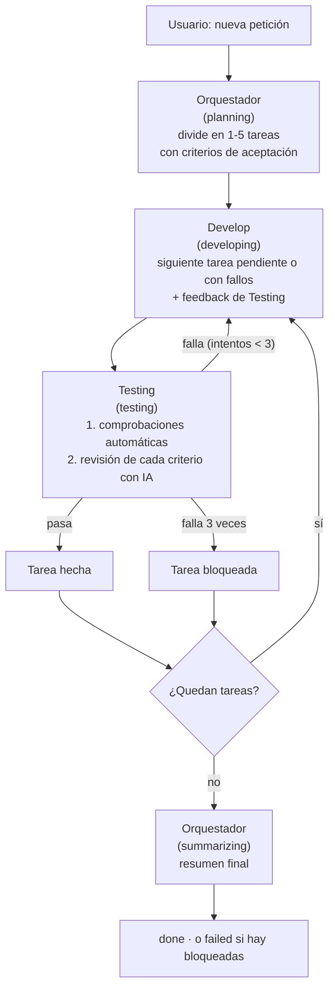

# Equipo de agentes IA

Tres agentes de IA que trabajan juntos sobre una web pequeña:

1. **Orquestador**: recibe una petición («añade una página de contacto a esta web»), la divide en tareas con criterios de aceptación y se las reparte a los otros dos. Al final redacta un resumen.
2. **Develop**: hace cada tarea modificando los archivos de la web.
3. **Testing**: comprueba lo que ha hecho Develop y le devuelve lo que falla, hasta que todo pasa (o hasta 3 intentos).

En pantalla se ve en directo qué hace cada agente, en qué estado está cada tarea, el registro de eventos y la web resultante.

- **Demo:** <!-- TODO: URL de Vercel -->
- **Usuario de prueba:** <!-- TODO: email y contraseña de prueba -->

La web sobre la que trabajan es la de un negocio ficticio, la «Panadería La Espiga» (`index.html`, `nosotros.html`, `styles.css`, `script.js`). Cada ejecución parte de una copia propia, así que las ejecuciones no se pisan.

## Stack

- **Next.js 16** (App Router, TypeScript, Tailwind) desplegado en **Vercel Hobby**.
- **Supabase** (plan gratuito): Postgres, Auth (email + contraseña) y Realtime.
- **LLM: Groq, Mistral y Google Gemini**, los tres en plan gratuito y sin tarjeta, con salida JSON estructurada. Groq y Mistral por su API compatible con OpenAI (`fetch` a `/chat/completions`, sin SDK); Gemini con el SDK `@google/genai`. Cada agente tiene su cadena de modelos (ver «Modelos de cada agente»).
- **Vitest** para los tests de la lógica.

## Arquitectura



### Un paso por petición (límite de Vercel)

En Vercel Hobby ninguna función puede durar más de 300 s (con Fluid Compute), y una ejecución completa encadena hasta ~30 llamadas al LLM. Por eso el motor es una **máquina de estados que avanza un solo paso por llamada** (`POST /api/runs/[id]/step`, `maxDuration = 300`): cada paso hace como mucho una llamada al LLM, guarda el resultado en la base de datos y devuelve el estado. La página de la ejecución llama a `step` en bucle mientras la ejecución no haya terminado.

- **Bloqueo:** antes de avanzar, el paso hace un `update` condicional sobre `runs.locked_until` (solo gana quien lo encuentra vacío o caducado). Si hay dos pestañas abiertas, la segunda recibe `busy` y espera; nunca se ejecutan dos pasos del mismo run a la vez.
- **Un modelo falla** (saturado, sin tiempo, sin cuota, no disponible, petición demasiado grande, JSON no válido…): se prueba el siguiente de la cadena del agente, aunque sea de otro proveedor (ver «Modelos de cada agente»). El `proveedor/modelo` que responde queda en el evento y se ve en el registro (en ámbar si ha sido un respaldo, con los que fallaron al pasar el ratón).
- **Todos los modelos de la cadena saturados o sin cuota:** el run no falla. Se registra el evento «modelos saturados, reintento en 15 s» o, si la cuota diaria está agotada, «cuota de la API agotada hasta las HH:MM; reintento en 12 h 22 min», el paso responde `retryAfter`, el bloqueo se alarga hasta esa hora y el navegador espera y reintenta.
- **Otros errores** (respuesta no válida, tiempo agotado…): se registran y se reintenta el paso; tras 3 errores seguidos el run se marca como `failed` con el motivo.
- **Directo:** la interfaz se suscribe con Supabase Realtime a `runs`, `tasks` y `events`. Antes de cada llamada al LLM se escribe un evento «trabajando en…», así la tarjeta del agente activo se ilumina mientras piensa. Si Realtime no conecta, la página consulta la base de datos cada 2 s.

### Cómo comprueba Testing

1. **Comprobaciones automáticas** sobre toda la web (no solo lo que ha tocado Develop): HTML no vacío y con las etiquetas principales bien cerradas, enlaces / hojas de estilo / scripts locales que existen y con rutas relativas, CSS con llaves equilibradas y JavaScript sin errores de sintaxis (se compila, no se ejecuta).
2. Si pasan, **revisión con IA de cada criterio de aceptación**, con un motivo por criterio. Si las automáticas fallan, no se gasta la llamada al LLM: el fallo vuelve directamente a Develop.

Lo que falla se guarda en `tasks.last_feedback` y es lo que recibe Develop en el siguiente intento.

### Proveedor de IA intercambiable

`LLM_PROVIDER=real|mock`:

- `real` (por defecto; `gemini`, el valor antiguo, vale igual): los agentes reales, cada uno con su cadena de modelos (ver abajo).
- `mock`: respuestas deterministas y plausibles sin clave de API, para desarrollar, probar y enseñar el flujo. Reconoce las peticiones de ejemplo (contacto, precios, modo oscuro) y la primera tarea falla siempre la primera revisión de Testing, para que se vea el bucle fallo → corrección → aprobado.

### Modelos de cada agente

El plan gratuito de Gemini resultó inservible para una demo: 503 casi siempre, una cuota diaria mínima y ejecuciones de más de 10 minutos. Por eso cada agente tiene una **cadena de modelos de varios proveedores**, todos con plan gratuito y sin tarjeta. Si el primero falla, se prueba el siguiente en la misma llamada:

| Agente | Principal | Respaldo, en orden | Por qué |
|---|---|---|---|
| Orquestador | Groq `openai/gpt-oss-120b` (`reasoning_effort: low`) | Groq `qwen/qwen3.8-27b` → Mistral `mistral-small-2603` → Gemini `gemini-3.5-flash` | 2 llamadas por ejecución con poco texto: Groq es el más rápido y cabe en su límite por petición. |
| Develop | Mistral `mistral-large-4` | Mistral `mistral-small-2603` → Groq `openai/gpt-oss-120b` → Gemini `gemini-3.5-flash-lite` | Devuelve archivos completos (respuestas largas): Mistral admite peticiones grandes; Groq da 413 por encima de ~8 K tokens. |
| Testing | Groq `openai/gpt-oss-120b` | Groq `qwen/qwen3.8-27b` → Groq `openai/gpt-oss-20b` → Mistral `mistral-small-2603` → Gemini `gemini-3.5-flash-lite` | Muchas llamadas con respuesta corta (un veredicto por criterio): rapidez de Groq, con varios modelos porque la cuota va por modelo. |

Gemini queda al final de las tres porque su plan gratuito está casi siempre saturado.

**Configuración.** `LLM_CHAIN_ORCHESTRATOR`, `LLM_CHAIN_DEVELOP` y `LLM_CHAIN_TESTING`, con eslabones `proveedor/modelo` separados por comas (el proveedor es lo que va antes de la primera barra: `groq/openai/gpt-oss-120b`). Proveedores: `groq`, `mistral` y `gemini`, con la clave en `GROQ_API_KEY`, `MISTRAL_API_KEY` y `GEMINI_API_KEY`. Un eslabón puede llevar opciones extra para la API tras `?` (`groq/openai/gpt-oss-120b?reasoning_effort=low`); `format=json_object` fuerza ese modo de JSON. Si una variable no está o está vacía, se usa la cadena de la tabla. **Un eslabón cuyo proveedor no tiene clave se salta** (queda en el log del servidor); si un agente se queda sin ninguno, es un error de configuración.

**Cuándo se pasa al siguiente modelo:** con cualquier error de la API. En concreto: 5xx (saturado), 504 o corte por tiempo, sin conexión, 429 (cuota de ese modelo; se lee `retry-after` o el `retryDelay` de Gemini), 404 o «not available in your subscription tier» (modelo que no existe o no entra en el plan), 413 (petición demasiado grande: el límite gratuito de Groq es de unos 8 K tokens por minuto, contando la petición, el tope de salida y los tokens de razonamiento de gpt-oss), 401/403 (clave rechazada) y JSON no válido o con la forma incorrecta (también el `json_validate_failed` de Groq y las respuestas cortadas por `max_tokens`). Otro 400 también pasa al siguiente: puede ser un parámetro que ese modelo no admite; si es de la petición, fallarán todos y el error del paso lo dirá.

**Al final de la cadena:** si algún modelo estaba saturado, sin tiempo o sin conexión, el paso se reintenta a los 15 s sin contar como error; si solo hubo 429, se espera la menor espera que haya pedido la API; si todos fallaron por otra cosa, es un error del paso (tras 3 seguidos, el run falla) con la lista de lo que ha fallado. Cada modelo tiene como mucho 120 s y la cadena entera, 240 s.

**JSON estructurado.** Cada agente tiene un solo esquema en JSON Schema plano ([`lib/llm/schemas.ts`](lib/llm/schemas.ts)) escrito para el modo estricto (todos los campos en `required`, `additionalProperties: false`, opcionales como `["string", "null"]`). Groq con gpt-oss y Mistral lo reciben como `response_format: json_schema` estricto; los demás modelos de Groq, como `json_object` con el esquema en el mensaje de sistema; Gemini, convertido a su `responseSchema`. La respuesta se valida contra el mismo esquema antes de dársela al motor.

**Migración desde la configuración solo de Gemini.** `GEMINI_MODEL`, `GEMINI_MODEL_ORCHESTRATOR`, `GEMINI_MODEL_DEVELOP`, `GEMINI_MODEL_TESTING` y `GEMINI_FALLBACK_MODELS` ya no se leen (si están, el servidor lo avisa en el log): bórralas y, si quieres otra cadena, ponla en `LLM_CHAIN_*` con el prefijo `gemini/`. Por ejemplo, la configuración anterior de Develop equivale a `LLM_CHAIN_DEVELOP=gemini/gemini-3.5-flash-lite,gemini/gemini-3.1-flash-lite,gemini/gemini-3.5-flash`. `LLM_PROVIDER=gemini` sigue funcionando como `real`.

Para comprobar las claves y cada eslabón:

```bash
npx tsx scripts/check-llm.ts                  # las tres cadenas; o solo algunas: ... develop testing
```

Lee las claves de `.env.local` o del entorno, sin imprimirlas, y hace una llamada mínima con el esquema real de cada agente a cada eslabón: `proveedor/modelo`, OK / FALLO / SIN CLAVE, código HTTP y tiempo. Un 503 o un 429 suelen ser pasajeros: conviene repetir antes de descartar un modelo.

### Prueba de extremo a extremo sin Supabase

```bash
npx tsx scripts/run-local.ts                                   # «Añade una página de contacto con formulario»
npx tsx scripts/run-local.ts "Añade un modo oscuro" --out /tmp/web
```

Ejecuta el motor completo con el repositorio en memoria y el proveedor de `LLM_PROVIDER` (las cadenas reales por defecto; con `LLM_PROVIDER=mock` no gasta cuota). Imprime cada petición a la API (`proveedor/modelo`, código y tiempo), los eventos y el estado de las tareas hasta `done` o `failed`, y con `--out` guarda la web resultante y los eventos. Si la API pide esperar más de 5 min (cuota diaria agotada) o se pulsa Ctrl+C, se detiene y guarda lo hecho hasta ese momento.

### Estructura

```
app/
  login/                     login con email y contraseña (sin registro público)
  page.tsx                   nueva petición + lista de ejecuciones
  runs/[id]/                 agentes, tablero de tareas, registro y vista previa
  api/runs/[id]/step         avanza un paso del motor
  api/runs/[id]/site/[...]   sirve la web generada para la vista previa
  actions.ts                 login, logout y crear ejecución
lib/
  engine/                    máquina de estados, aplicación de cambios y comprobaciones (lógica pura)
  llm/                       cadenas de modelos (chain), Groq/Mistral (openai-compatible), Gemini, esquemas y mock
  supabase/                  clientes (usuario, navegador, servicio) y repositorio
  template.ts                web de partida
proxy.ts                     refresca la sesión y exige login
supabase/migrations/         esquema SQL
scripts/create-test-user.ts  crea el usuario de prueba
scripts/check-llm.ts         prueba cada modelo de las cadenas de los agentes
scripts/run-local.ts         ejecución completa en local, sin Supabase
tests/                       Vitest
```

## Modelo de datos

| Tabla | Contenido |
|---|---|
| `runs` | Una ejecución: petición, estado (`planning → developing ⇄ testing → summarizing → done/failed`), resumen final, errores seguidos y `locked_until` para el bloqueo. |
| `tasks` | Tareas del Orquestador: título, descripción, criterios de aceptación (`jsonb`), estado (`pending`, `developing`, `testing`, `failed`, `done`, `blocked`), fallos de Testing y último feedback. |
| `run_files` | Archivos de la web de cada ejecución (`run_id` + `path`). |
| `events` | Registro de lo que hace cada agente (`orchestrator`, `develop`, `testing`, `system`), con un mensaje legible y el detalle en `payload`. |

Seguridad: RLS activado en las cuatro tablas; cada usuario solo puede **leer** sus ejecuciones. Todas las escrituras las hace el servidor con la service role key, que nunca llega al navegador. El esquema completo está en [`supabase/migrations/0001_init.sql`](supabase/migrations/0001_init.sql).

La vista previa se sirve en `/api/runs/[id]/site/...` con el `content-type` correcto (así funcionan los enlaces entre páginas). Como su HTML y JavaScript los ha escrito un LLM, se sirve aislada: cabecera `Content-Security-Policy: sandbox` e iframe con `sandbox`, sin acceso a la sesión ni a la API de la aplicación. El id de la ejecución (UUID) hace de enlace secreto.

## Arranque en local

Requisitos: Node 22 y un proyecto de Supabase (el plan gratuito sirve).

```bash
npm install
cp .env.example .env.local      # y rellena los valores
npm run dev                     # http://localhost:3000
```

Para probar sin claves de IA, pon `LLM_PROVIDER=mock` en `.env.local`. Con una sola clave (p. ej. solo `GEMINI_API_KEY`) también funciona: cada agente usa los eslabones de su cadena que tengan clave.

Antes del primer arranque hay que preparar Supabase (abajo) y crear un usuario:

```bash
npx tsx scripts/create-test-user.ts prueba@ejemplo.com 'una-contraseña-larga'
```

El script lee `NEXT_PUBLIC_SUPABASE_URL` y `SUPABASE_SERVICE_ROLE_KEY` de `.env.local`. Si el usuario ya existe, le actualiza la contraseña.

### Variables de entorno

| Variable | Dónde se usa |
|---|---|
| `NEXT_PUBLIC_SUPABASE_URL` | Navegador y servidor |
| `NEXT_PUBLIC_SUPABASE_ANON_KEY` | Clave pública (anon o publishable). Navegador y servidor |
| `SUPABASE_SERVICE_ROLE_KEY` | Solo servidor: escrituras del motor y vista previa |
| `GROQ_API_KEY` | Solo servidor. [console.groq.com/keys](https://console.groq.com/keys), plan gratuito |
| `MISTRAL_API_KEY` | Solo servidor. [console.mistral.ai](https://console.mistral.ai) → API Keys, plan gratuito (Experiment) |
| `GEMINI_API_KEY` | Solo servidor. [aistudio.google.com/apikey](https://aistudio.google.com/apikey), plan gratuito |
| `LLM_CHAIN_ORCHESTRATOR`, `LLM_CHAIN_DEVELOP`, `LLM_CHAIN_TESTING` | Opcionales: cadena de modelos de cada agente (ver «Modelos de cada agente») |
| `LLM_PROVIDER` | `real` (por defecto) o `mock` |
| `MAX_RUNS_PER_DAY` | Ejecuciones por usuario cada 24 h, por defecto 15 |
| `MAX_RUNS_PER_HOUR` | Ejecuciones de todos los usuarios juntos en la última hora, por defecto 4 |
| `MOCK_DELAY_MS` | Opcional, retardo simulado del modo mock (por defecto 1500 ms) |

## Despliegue

### Supabase

1. Crea un proyecto en [supabase.com](https://supabase.com) (plan gratuito).
2. **SQL Editor** → pega el contenido de `supabase/migrations/0001_init.sql` y ejecútalo. Crea las tablas, las políticas RLS y añade `runs`, `tasks` y `events` a la publicación de Realtime.
3. Comprueba en **Database → Publications → supabase_realtime** que las tres tablas están activadas.
4. **Authentication → Sign In / Providers**: desactiva «Allow new users to sign up» (no hay registro público; los usuarios se crean con el script).
5. Copia la URL del proyecto (botón **Connect** o **Project Settings → Data API**) y las claves de **Project Settings → API Keys**: la *publishable* (`sb_publishable_…`, o la `anon` de *Legacy API keys*) va en `NEXT_PUBLIC_SUPABASE_ANON_KEY`, y una *secret key* (`sb_secret_…`, o la `service_role` legacy) en `SUPABASE_SERVICE_ROLE_KEY`.

### Vercel

1. Importa el repositorio en [vercel.com](https://vercel.com) (plan Hobby). No hace falta configurar nada del build.
2. En **Settings → Environment Variables** añade las variables de la tabla anterior.
3. Despliega y crea el usuario de prueba con el script.

## Tests

```bash
npm test        # Vitest
npm run lint
npm run build
```

Los tests cubren la lógica pura con el proveedor mock y un repositorio en memoria (detrás de la misma interfaz que el de Supabase): transiciones de la máquina de estados, aplicación de cambios a los archivos, comprobaciones automáticas de Testing, el bucle fallo → reintento → bloqueo, los límites por usuario y global por hora, el bloqueo entre pasos simultáneos (incluida la relectura del run tras bloquearlo), los pasos cortados a mitad y los errores repetidos. De los modelos: el parseo de las cadenas, los eslabones sin clave, el respaldo entre proveedores (503, 504, 404, 413, 429, 400, «no disponible en tu plan», sin conexión, corte por tiempo y JSON inválido o con forma incorrecta), el cuerpo de la petición a Groq y Mistral con `fetch` simulado, los errores del SDK de Gemini, los esquemas y el formato de las esperas largas. No hacen llamadas reales.

## Límites conocidos

- **Cuotas gratuitas de los proveedores:** pocas peticiones o tokens por minuto y por día, por modelo. Una ejecución hace entre ~5 y ~32 llamadas. Para protegerlas: máximo 5 tareas por ejecución, 3 intentos por tarea, `MAX_RUNS_PER_DAY` ejecuciones por usuario cada 24 h y `MAX_RUNS_PER_HOUR` ejecuciones en la última hora entre todos los usuarios (las cuotas son de las claves, no de cada usuario). Al llegar al límite por hora, el formulario dice a qué hora (de Madrid) queda libre el siguiente hueco. Si se agota la cuota diaria, la ejecución queda esperando y reintentando mientras la página esté abierta.
- **El motor avanza mientras la página está abierta.** Si se cierra, la ejecución se queda en su estado y continúa al volver a abrirla. Para que avanzara sola haría falta una cola o un cron (fuera del plan gratuito y del alcance de la prueba).
- **Develop devuelve archivos completos**, no diffs. Es lo más fiable con webs pequeñas como esta; con archivos grandes habría que pasar a parches.
- **Las comprobaciones automáticas son heurísticas** (sin navegador real): detectan HTML roto, enlaces rotos y errores de sintaxis, pero no errores en tiempo de ejecución ni problemas visuales. Esa parte la cubre la revisión con IA, que puede equivocarse.
- **Cada paso tiene hasta 300 s.** La llamada al LLM se corta a los 240 s y cuenta como error reintentable; el bloqueo del run caduca a los 320 s por si un paso se queda colgado.
- Los formularios de la web de demo no envían nada: la vista previa responde con un aviso.

## Cómo se ha programado con Claude Code

<!-- TODO: lo completa Alejandro -->
