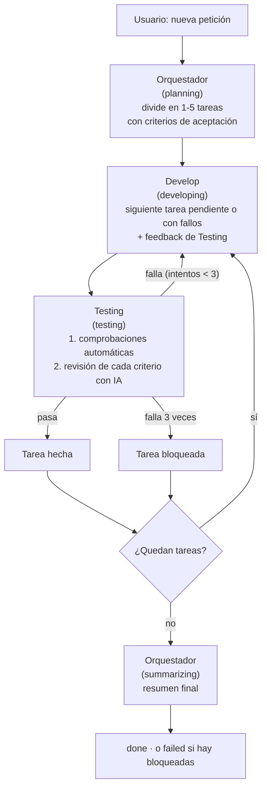

# Equipo de agentes IA

Tres agentes de IA que trabajan juntos sobre una web pequeña:

1. **Orquestador**: recibe una petición («añade una página de contacto a esta web»), la divide en tareas con criterios de aceptación y se las reparte a los otros dos. Al final redacta un resumen.
2. **Develop**: hace cada tarea modificando los archivos de la web.
3. **Testing**: comprueba lo que ha hecho Develop y le devuelve lo que falla, hasta que todo pasa (o hasta 3 intentos).

En pantalla se ve en directo qué hace cada agente, en qué estado está cada tarea, el registro de eventos y la web resultante.

- **Demo:** <!-- TODO: URL de Vercel -->
- **Usuario de prueba:** <!-- TODO: email y contraseña de prueba -->

La web sobre la que trabajan es la de un negocio ficticio, la «Panadería La Espiga» (`index.html`, `nosotros.html`, `styles.css`, `script.js`). Cada ejecución parte de una copia propia, así que las ejecuciones no se pisan.

## Stack

- **Next.js 16** (App Router, TypeScript, Tailwind) desplegado en **Vercel Hobby**.
- **Supabase** (plan gratuito): Postgres, Auth (email + contraseña) y Realtime.
- **LLM: Claude** (Opus 5.5 para el Orquestador, Sonnet 5.5 para Develop y Testing) con la suscripción de Claude, mediante el **Claude Agent SDK** (`@anthropic-ai/claude-agent-sdk`) y `CLAUDE_CODE_OAUTH_TOKEN`. Ver «Modelos: por qué la suscripción de Claude».
- **Vitest** para los tests de la lógica.

## Arquitectura



### Un paso por petición (límite de Vercel)

En Vercel Hobby ninguna función puede durar más de 300 s (con Fluid Compute), y una ejecución completa encadena hasta ~32 llamadas al LLM. Por eso el motor es una **máquina de estados que avanza un solo paso por llamada** (`POST /api/runs/[id]/step`, `maxDuration = 300`): cada paso hace como mucho una llamada al LLM, guarda el resultado en la base de datos y devuelve el estado. La página de la ejecución llama a `step` en bucle mientras la ejecución no haya terminado.

- **Bloqueo:** antes de avanzar, el paso hace un `update` condicional sobre `runs.locked_until` (solo gana quien lo encuentra vacío o caducado). Si hay dos pestañas abiertas, la segunda recibe `busy` y espera; nunca se ejecutan dos pasos del mismo run a la vez.
- **Un modelo falla** (saturado, sin tiempo, en su límite de uso, no disponible o con JSON no válido dos veces): se prueba el siguiente modelo del agente (el Orquestador pasa de Opus a Sonnet). El modelo que responde queda en el evento y se ve en el registro (en ámbar si ha sido un respaldo, con los que fallaron al pasar el ratón).
- **Claude saturado o en el límite de uso de la suscripción:** el run no falla. Se registra «Claude saturado…, reintento en 15 s» o «límite de uso de la suscripción alcanzado hasta las HH:MM», el paso responde `retryAfter`, el bloqueo se alarga hasta esa hora y el navegador espera y reintenta.
- **Sin sesión, token rechazado o una credencial que no es la suscripción:** el run se marca como `failed` en el acto con el motivo (reintentar no lo arregla).
- **Otros errores** (respuesta no válida, fallo del CLI…): se registran y se reintenta el paso; tras 3 errores seguidos el run se marca como `failed` con el motivo.
- **Directo:** la interfaz se suscribe con Supabase Realtime a `runs`, `tasks` y `events`. Antes de cada llamada al LLM se escribe un evento «trabajando en…», así la tarjeta del agente activo se ilumina mientras piensa. Si Realtime no conecta, la página consulta la base de datos cada 2 s.

### Cómo comprueba Testing

1. **Comprobaciones automáticas** sobre toda la web (no solo lo que ha tocado Develop): HTML no vacío y con las etiquetas principales bien cerradas, enlaces / hojas de estilo / scripts locales que existen y con rutas relativas, CSS con llaves equilibradas y JavaScript sin errores de sintaxis (se compila, no se ejecuta).
2. Si pasan, **revisión con IA de cada criterio de aceptación**, con un motivo por criterio. Si las automáticas fallan, no se gasta la llamada al LLM: el fallo vuelve directamente a Develop.

Lo que falla se guarda en `tasks.last_feedback` y es lo que recibe Develop en el siguiente intento.

### Proveedor de IA intercambiable

`LLM_PROVIDER=claude|mock`:

- `claude` (por defecto): los agentes reales, con los modelos de cada uno (ver abajo).
- `mock`: respuestas deterministas y plausibles sin gastar la suscripción, para desarrollar, probar y enseñar el flujo. Reconoce las peticiones de ejemplo (contacto, precios, modo oscuro) y la primera tarea falla siempre la primera revisión de Testing, para que se vea el bucle fallo → corrección → aprobado.

### Modelos: por qué la suscripción de Claude

La primera versión usaba el plan gratuito de Google Gemini. En las pruebas respondía 503 (modelo saturado) en la mayoría de las llamadas, agotó la cuota diaria y una ejecución completa llegó a tardar más de 10 minutos. Para una demo que tiene que responder cuando la abra otra persona no era viable, así que los agentes usan Claude con una suscripción de Claude (el mismo modelo con el que se ha desarrollado el proyecto).

| Agente | Modelo | Por qué |
|---|---|---|
| Orquestador | `claude-opus-5-5` (respaldo: `claude-sonnet-5-5`) | Hace de arquitecto: decide cómo se divide la petición y con qué criterios se aceptará cada tarea. Son 2 llamadas por ejecución y de ellas depende todo lo demás, así que va el modelo más capaz. |
| Develop | `claude-sonnet-5-5` | Devuelve archivos completos en cada intento: hace falta rapidez para caber en el paso de 300 s. |
| Testing | `claude-sonnet-5-5` | Una llamada por revisión, con respuesta corta (un veredicto por criterio). |

Se cambian con `CLAUDE_MODELS_ORCHESTRATOR`, `CLAUDE_MODELS_DEVELOP` y `CLAUDE_MODELS_TESTING` (modelos separados por comas, el primero que responda). Para comprobar que entra por la suscripción y que cada modelo responde:

```bash
npx tsx scripts/check-claude.ts
```

**Suscripción, no API de pago.** El SDK lanza el CLI de Claude Code como subproceso ([`lib/llm/claude.ts`](lib/llm/claude.ts)):

- El subproceso recibe un entorno mínimo construido desde cero (el SDK no lo mezcla con el de la app): `PATH`, idioma, certificados y proxy, `TZ` y `CLAUDE_CODE_OAUTH_TOKEN`. Nunca `ANTHROPIC_API_KEY`, `ANTHROPIC_AUTH_TOKEN`, las variables de Bedrock/Vertex/Foundry ni las de Supabase.
- `HOME` y `CLAUDE_CONFIG_DIR` apuntan a un directorio vacío propio en `/tmp`, que también es el `cwd`: el CLI no ve el código de la app, ni ajustes, ni CLAUDE.md.
- Solo generación: sin herramientas del SDK (`tools: []`), sin servidores MCP, sin `settingSources`, un único turno, sin guardar la sesión y con el prompt literal (`verbatimPrompts`: el HTML de la web no se interpreta como `@archivo` ni `/comando`).
- Si el mensaje `init` del CLI dice que la credencial no es la suscripción (`apiKeySource` distinto de `none`) o anuncia alguna herramienta, la llamada se corta y el run falla con el motivo. También se corta si el CLI avisa de que está usando uso extra de pago (*overage*); conviene tenerlo desactivado en la cuenta.
- En Vercel `CLAUDE_CODE_OAUTH_TOKEN` es obligatorio. En local, sin token, usa la sesión de Claude Code del equipo.

**JSON.** Cada agente tiene su esquema en JSON Schema ([`lib/llm/schemas.ts`](lib/llm/schemas.ts)), que va en el prompt de sistema. La respuesta se valida contra él; si no es JSON válido o le falta algo, se le pide otra vez al mismo modelo con el error y, si vuelve a fallar, pasa al siguiente.

**Límites para proteger la suscripción.** Una ejecución hace entre ~5 y ~32 llamadas. Máximo 5 tareas por ejecución y 3 intentos por tarea, `MAX_RUNS_PER_HOUR` ejecuciones en la última hora entre todos los usuarios (3 por defecto) y `MAX_RUNS_PER_DAY` por usuario cada 24 h (10 por defecto). Al llegar al límite por hora, el formulario dice a qué hora (de Madrid) queda libre el siguiente hueco.

**Tiempos.** Cada intento tiene como mucho 180 s y la llamada entera, respaldos incluidos, 240 s.

### Prueba de extremo a extremo sin Supabase

```bash
npx tsx scripts/run-local.ts                                   # «Añade una página de contacto con formulario»
npx tsx scripts/run-local.ts "Añade un modo oscuro" --out /tmp/web
```

Ejecuta el motor completo con el repositorio en memoria y el proveedor de `LLM_PROVIDER` (Claude por defecto; con `LLM_PROVIDER=mock` no gasta la suscripción). Imprime cada llamada a Claude (modelo, tiempo y tokens), los eventos y el estado de las tareas hasta `done` o `failed`, y con `--out` guarda la web resultante y los eventos. Si hay que esperar más de 5 min por el límite de uso o se pulsa Ctrl+C, se detiene y guarda lo hecho hasta ese momento.

### Estructura

```
app/
  login/                     login con email y contraseña (sin registro público)
  page.tsx                   nueva petición + lista de ejecuciones
  runs/[id]/                 agentes, tablero de tareas, registro y vista previa
  api/runs/[id]/step         avanza un paso del motor
  api/runs/[id]/site/[...]   sirve la web generada para la vista previa
  actions.ts                 login, logout y crear ejecución
lib/
  engine/                    máquina de estados, aplicación de cambios y comprobaciones (lógica pura)
  llm/                       Claude (SDK y CLI comprimido para Vercel), modelos por agente, esquemas y mock
  supabase/                  clientes (usuario, navegador, servicio) y repositorio
  template.ts                web de partida
proxy.ts                     refresca la sesión y exige login
supabase/migrations/         esquema SQL
scripts/create-test-user.ts  crea el usuario de prueba
scripts/check-claude.ts      comprueba la suscripción y cada modelo de los agentes
scripts/pack-claude-cli.mjs  comprime el CLI de Linux para la función de Vercel (en el build)
scripts/run-local.ts         ejecución completa en local, sin Supabase
tests/                       Vitest
```

## Modelo de datos

| Tabla | Contenido |
|---|---|
| `runs` | Una ejecución: petición, estado (`planning → developing ⇄ testing → summarizing → done/failed`), resumen final, errores seguidos y `locked_until` para el bloqueo. |
| `tasks` | Tareas del Orquestador: título, descripción, criterios de aceptación (`jsonb`), estado (`pending`, `developing`, `testing`, `failed`, `done`, `blocked`), fallos de Testing y último feedback. |
| `run_files` | Archivos de la web de cada ejecución (`run_id` + `path`). |
| `events` | Registro de lo que hace cada agente (`orchestrator`, `develop`, `testing`, `system`), con un mensaje legible y el detalle en `payload`. |

Seguridad: RLS activado en las cuatro tablas; cada usuario solo puede **leer** sus ejecuciones. Todas las escrituras las hace el servidor con la service role key, que nunca llega al navegador. El esquema completo está en [`supabase/migrations/0001_init.sql`](supabase/migrations/0001_init.sql).

La vista previa se sirve en `/api/runs/[id]/site/...` con el `content-type` correcto (así funcionan los enlaces entre páginas). Como su HTML y JavaScript los ha escrito un LLM, se sirve aislada: cabecera `Content-Security-Policy: sandbox` e iframe con `sandbox`, sin acceso a la sesión ni a la API de la aplicación. El id de la ejecución (UUID) hace de enlace secreto.

## Arranque en local

Requisitos: Node 22 y un proyecto de Supabase (el plan gratuito sirve).

```bash
npm install
cp .env.example .env.local      # y rellena los valores
npm run dev                     # http://localhost:3000
```

Con la sesión de Claude Code iniciada en el equipo no hace falta token. Para probar sin gastar la suscripción, pon `LLM_PROVIDER=mock` en `.env.local`.

Antes del primer arranque hay que preparar Supabase (abajo) y crear un usuario:

```bash
npx tsx scripts/create-test-user.ts prueba@ejemplo.com 'una-contraseña-larga'
```

El script lee `NEXT_PUBLIC_SUPABASE_URL` y `SUPABASE_SERVICE_ROLE_KEY` de `.env.local`. Si el usuario ya existe, le actualiza la contraseña.

### Variables de entorno

| Variable | Dónde se usa |
|---|---|
| `NEXT_PUBLIC_SUPABASE_URL` | Navegador y servidor |
| `NEXT_PUBLIC_SUPABASE_ANON_KEY` | Clave pública (anon o publishable). Navegador y servidor |
| `SUPABASE_SERVICE_ROLE_KEY` | Solo servidor: escrituras del motor y vista previa |
| `CLAUDE_CODE_OAUTH_TOKEN` | Solo servidor. Token de la suscripción de Claude (`claude setup-token`). Obligatorio en Vercel |
| `CLAUDE_MODELS_ORCHESTRATOR`, `CLAUDE_MODELS_DEVELOP`, `CLAUDE_MODELS_TESTING` | Opcionales: modelos de cada agente (ver «Modelos: por qué la suscripción de Claude») |
| `LLM_PROVIDER` | `claude` (por defecto) o `mock` |
| `MAX_RUNS_PER_HOUR` | Ejecuciones de todos los usuarios juntos en la última hora, por defecto 3 |
| `MAX_RUNS_PER_DAY` | Ejecuciones por usuario cada 24 h, por defecto 10 |
| `MOCK_DELAY_MS` | Opcional, retardo simulado del modo mock (por defecto 1500 ms) |

## Despliegue

### Supabase

1. Crea un proyecto en [supabase.com](https://supabase.com) (plan gratuito).
2. **SQL Editor** → pega el contenido de `supabase/migrations/0001_init.sql` y ejecútalo. Crea las tablas, las políticas RLS y añade `runs`, `tasks` y `events` a la publicación de Realtime.
3. Comprueba en **Database → Publications → supabase_realtime** que las tres tablas están activadas.
4. **Authentication → Sign In / Providers**: desactiva «Allow new users to sign up» (no hay registro público; los usuarios se crean con el script).
5. Copia la URL del proyecto (botón **Connect** o **Project Settings → Data API**) y las claves de **Project Settings → API Keys**: la *publishable* (`sb_publishable_…`, o la `anon` de *Legacy API keys*) va en `NEXT_PUBLIC_SUPABASE_ANON_KEY`, y una *secret key* (`sb_secret_…`, o la `service_role` legacy) en `SUPABASE_SERVICE_ROLE_KEY`.

### Vercel

1. Importa el repositorio en [vercel.com](https://vercel.com) (plan Hobby). No hace falta configurar nada del build.
2. En **Settings → Environment Variables** añade las variables de la tabla anterior (al menos las de Supabase y `CLAUDE_CODE_OAUTH_TOKEN`).
3. Despliega y crea el usuario de prueba con el script.

#### El CLI de Claude en una función de Vercel

El SDK necesita el binario del CLI de Claude Code. El de Linux x64 (glibc) ocupa ~381 MB y una función de Vercel admite 250 MB sin comprimir, así que no cabe tal cual:

- En el build (`npm run build` → [`scripts/pack-claude-cli.mjs`](scripts/pack-claude-cli.mjs), solo cuando `VERCEL=1`) se toma el binario del paquete `@anthropic-ai/claude-agent-sdk-linux-x64` de la misma versión que el SDK, se comprueba su sha256 con el manifiesto del SDK y se comprime con brotli (calidad 9): ~137 MB en `.claude-cli/` (no va a git).
- `next.config.ts` incluye ese archivo solo en la función del paso (`outputFileTracingIncludes`) y excluye los paquetes nativos del SDK de todas las funciones. El SDK va como paquete externo (`serverExternalPackages`). Medido con el trazado de `next build` (`route.js.nft.json`), la función del paso suma ~150 MB, de los que 144 MB son el CLI comprimido.
- En el arranque en frío, [`lib/llm/claude-cli.ts`](lib/llm/claude-cli.ts) lo descomprime en `/tmp` (unos segundos, una vez por instancia y con un bloqueo para no hacerlo dos veces; se escribe en un archivo temporal y se renombra) y se le pasa al SDK con `pathToClaudeCodeExecutable`.
- En local (macOS) no se descomprime nada: el SDK usa el binario de su paquete para la plataforma.

Para probar el empaquetado en local: `npm run pack-claude-cli` y después `npm run build`.

**Alternativa no implementada:** la variable de entorno `VERCEL_SUPPORT_LARGE_FUNCTIONS` de Vercel admite funciones más grandes, lo que permitiría incluir el binario sin comprimir y ahorrar la descompresión del arranque en frío. No se ha usado porque con la compresión basta el límite estándar.

## Tests

```bash
npm test        # Vitest
npm run lint
npm run build
```

Los tests cubren la lógica pura con el proveedor mock y un repositorio en memoria (detrás de la misma interfaz que el de Supabase): transiciones de la máquina de estados, aplicación de cambios a los archivos, comprobaciones automáticas de Testing, el bucle fallo → reintento → bloqueo, los límites por usuario y global por hora (y sus valores por defecto), el bloqueo entre pasos simultáneos (incluida la relectura del run tras bloquearlo), los pasos cortados a mitad, los errores repetidos y los fatales. Del proveedor de Claude, con un `query` simulado: el entorno limpio del subproceso, el corte si la credencial no es la suscripción o hay herramientas, el mapeo de errores (límite de uso, uso extra, saturación, modelo inexistente, sin sesión, facturación, tiempo agotado), el reintento por JSON no válido, el respaldo Opus → Sonnet y la descompresión del CLI. No hacen llamadas reales.

## Límites conocidos

- **Límite de uso de la suscripción:** las ejecuciones de todos los usuarios gastan la misma suscripción. Los límites por hora y por usuario lo protegen; si aun así se llega al límite de uso, la ejecución queda esperando y reintentando mientras la página esté abierta.
- **Arranque en frío:** la primera llamada de cada instancia de Vercel descomprime el CLI (unos segundos) y cada llamada arranca un proceso del CLI (unos segundos más que una llamada HTTP directa).
- **El motor avanza mientras la página está abierta.** Si se cierra, la ejecución se queda en su estado y continúa al volver a abrirla. Para que avanzara sola haría falta una cola o un cron (fuera del plan gratuito y del alcance de la prueba).
- **Develop devuelve archivos completos**, no diffs. Es lo más fiable con webs pequeñas como esta; con archivos grandes habría que pasar a parches.
- **Las comprobaciones automáticas son heurísticas** (sin navegador real): detectan HTML roto, enlaces rotos y errores de sintaxis, pero no errores en tiempo de ejecución ni problemas visuales. Esa parte la cubre la revisión con IA, que puede equivocarse.
- **Cada paso tiene hasta 300 s.** La llamada al LLM se corta a los 240 s y se reintenta; el bloqueo del run caduca a los 320 s por si un paso se queda colgado.
- Los formularios de la web de demo no envían nada: la vista previa responde con un aviso.

## Cómo se ha programado con Claude Code

<!-- TODO: lo completa Alejandro -->
