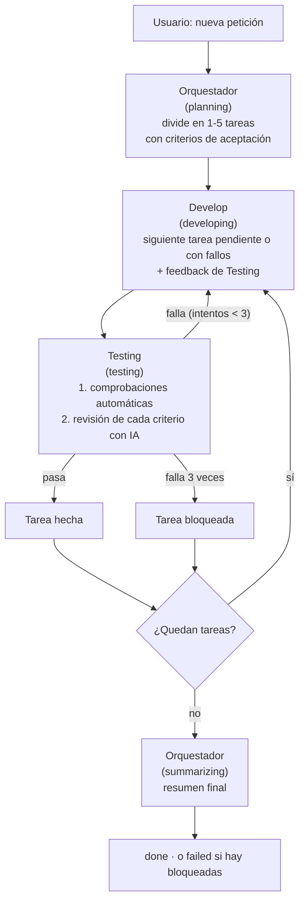

# Equipo de agentes IA

Tres agentes de IA que trabajan juntos sobre una web pequeña:

1. **Orquestador**: recibe una petición («añade una página de contacto a esta web»), la divide en tareas con criterios de aceptación y se las reparte a los otros dos. Al final redacta un resumen.
2. **Develop**: hace cada tarea modificando los archivos de la web.
3. **Testing**: comprueba lo que ha hecho Develop y le devuelve lo que falla, hasta que todo pasa (o hasta 3 intentos).

En pantalla se ve en directo qué hace cada agente, en qué estado está cada tarea, el registro de eventos y la web resultante.

- **Demo:** <!-- TODO: URL de Vercel -->
- **Usuario de prueba:** <!-- TODO: email y contraseña de prueba -->

La web sobre la que trabajan es la de un negocio ficticio, la «Panadería La Espiga» (`index.html`, `nosotros.html`, `styles.css`, `script.js`). Cada ejecución parte de una copia propia, así que las ejecuciones no se pisan.

## Stack

- **Next.js 16** (App Router, TypeScript, Tailwind) desplegado en **Vercel Hobby**.
- **Supabase** (plan gratuito): Postgres, Auth (email + contraseña) y Realtime.
- **Google Gemini** (plan gratuito) con el SDK `@google/genai` y salida JSON estructurada (`responseMimeType: application/json` + `responseSchema`).
- **Vitest** para los tests de la lógica.

## Arquitectura



### Un paso por petición (límite de Vercel)

En Vercel Hobby ninguna función puede durar más de 60 s, y una ejecución completa encadena hasta ~30 llamadas al LLM. Por eso el motor es una **máquina de estados que avanza un solo paso por llamada** (`POST /api/runs/[id]/step`, `maxDuration = 60`): cada paso hace como mucho una llamada al LLM, guarda el resultado en la base de datos y devuelve el estado. La página de la ejecución llama a `step` en bucle mientras la ejecución no haya terminado.

- **Bloqueo:** antes de avanzar, el paso hace un `update` condicional sobre `runs.locked_until` (solo gana quien lo encuentra vacío o caducado). Si hay dos pestañas abiertas, la segunda recibe `busy` y espera; nunca se ejecutan dos pasos del mismo run a la vez.
- **Límite de la API (429) o modelo saturado (503):** el run no falla. Se registra el evento «límite de la API, reintento en X s», el paso responde `retryAfter`, el bloqueo se alarga hasta esa hora y el navegador espera y reintenta.
- **Otros errores** (respuesta no válida, tiempo agotado…): se registran y se reintenta el paso; tras 3 errores seguidos el run se marca como `failed` con el motivo.
- **Directo:** la interfaz se suscribe con Supabase Realtime a `runs`, `tasks` y `events`. Antes de cada llamada al LLM se escribe un evento «trabajando en…», así la tarjeta del agente activo se ilumina mientras piensa. Si Realtime no conecta, la página consulta la base de datos cada 2 s.

### Cómo comprueba Testing

1. **Comprobaciones automáticas** sobre toda la web (no solo lo que ha tocado Develop): HTML no vacío y con las etiquetas principales bien cerradas, enlaces / hojas de estilo / scripts locales que existen y con rutas relativas, CSS con llaves equilibradas y JavaScript sin errores de sintaxis (se compila, no se ejecuta).
2. Si pasan, **revisión con IA de cada criterio de aceptación**, con un motivo por criterio. Si las automáticas fallan, no se gasta la llamada al LLM: el fallo vuelve directamente a Develop.

Lo que falla se guarda en `tasks.last_feedback` y es lo que recibe Develop en el siguiente intento.

### Proveedor de IA intercambiable

`LLM_PROVIDER=gemini|mock`:

- `gemini`: los agentes reales, cada uno con su modelo (ver abajo).
- `mock`: respuestas deterministas y plausibles sin clave de API, para desarrollar, probar y enseñar el flujo. Reconoce las peticiones de ejemplo (contacto, precios, modo oscuro) y la primera tarea falla siempre la primera revisión de Testing, para que se vea el bucle fallo → corrección → aprobado.

### Modelo de cada agente

La cuota gratuita de Gemini va por modelo, y los agentes no gastan igual: el Orquestador hace 2 llamadas por ejecución (planificar y resumir) y Develop y Testing hacen el resto (hasta ~30). Por eso cada agente tiene su modelo:

| Agente | Variable | Por defecto |
|---|---|---|
| Orquestador | `GEMINI_MODEL_ORCHESTRATOR` | `gemini-3.8-flash` (Flash: mejor para planificar, menos cuota) |
| Develop | `GEMINI_MODEL_DEVELOP` | `gemini-3.5-flash-lite` (Flash-Lite: más peticiones al día) |
| Testing | `GEMINI_MODEL_TESTING` | `gemini-3.5-flash-lite` |

Si falta la variable de un agente se usa `GEMINI_MODEL`, y si tampoco está, el valor por defecto. Los nombres por defecto son los Flash y Flash-Lite más recientes que aparecen en los tipos de `@google/genai` 3.6.1; **que estén disponibles para tu clave y en el plan gratuito se comprueba con la clave**:

```bash
GEMINI_API_KEY=... npx tsx scripts/check-gemini.ts   # o con la clave en .env.local
```

El script lista los modelos «flash» de la cuenta y hace una llamada mínima con JSON estructurado a cada modelo configurado. Las cuotas exactas de cada modelo se ven en AI Studio.

### Estructura

```
app/
  login/                     login con email y contraseña (sin registro público)
  page.tsx                   nueva petición + lista de ejecuciones
  runs/[id]/                 agentes, tablero de tareas, registro y vista previa
  api/runs/[id]/step         avanza un paso del motor
  api/runs/[id]/site/[...]   sirve la web generada para la vista previa
  actions.ts                 login, logout y crear ejecución
lib/
  engine/                    máquina de estados, aplicación de cambios y comprobaciones (lógica pura)
  llm/                       proveedores Gemini y mock
  supabase/                  clientes (usuario, navegador, servicio) y repositorio
  template.ts                web de partida
proxy.ts                     refresca la sesión y exige login
supabase/migrations/         esquema SQL
scripts/create-test-user.ts  crea el usuario de prueba
tests/                       Vitest
```

## Modelo de datos

| Tabla | Contenido |
|---|---|
| `runs` | Una ejecución: petición, estado (`planning → developing ⇄ testing → summarizing → done/failed`), resumen final, errores seguidos y `locked_until` para el bloqueo. |
| `tasks` | Tareas del Orquestador: título, descripción, criterios de aceptación (`jsonb`), estado (`pending`, `developing`, `testing`, `failed`, `done`, `blocked`), fallos de Testing y último feedback. |
| `run_files` | Archivos de la web de cada ejecución (`run_id` + `path`). |
| `events` | Registro de lo que hace cada agente (`orchestrator`, `develop`, `testing`, `system`), con un mensaje legible y el detalle en `payload`. |

Seguridad: RLS activado en las cuatro tablas; cada usuario solo puede **leer** sus ejecuciones. Todas las escrituras las hace el servidor con la service role key, que nunca llega al navegador. El esquema completo está en [`supabase/migrations/0001_init.sql`](supabase/migrations/0001_init.sql).

La vista previa se sirve en `/api/runs/[id]/site/...` con el `content-type` correcto (así funcionan los enlaces entre páginas). Como su HTML y JavaScript los ha escrito un LLM, se sirve aislada: cabecera `Content-Security-Policy: sandbox` e iframe con `sandbox`, sin acceso a la sesión ni a la API de la aplicación. El id de la ejecución (UUID) hace de enlace secreto.

## Arranque en local

Requisitos: Node 22 y un proyecto de Supabase (el plan gratuito sirve).

```bash
npm install
cp .env.example .env.local      # y rellena los valores
npm run dev                     # http://localhost:3000
```

Para probar sin clave de Gemini, pon `LLM_PROVIDER=mock` en `.env.local`.

Antes del primer arranque hay que preparar Supabase (abajo) y crear un usuario:

```bash
npx tsx scripts/create-test-user.ts prueba@ejemplo.com 'una-contraseña-larga'
```

El script lee `NEXT_PUBLIC_SUPABASE_URL` y `SUPABASE_SERVICE_ROLE_KEY` de `.env.local`. Si el usuario ya existe, le actualiza la contraseña.

### Variables de entorno

| Variable | Dónde se usa |
|---|---|
| `NEXT_PUBLIC_SUPABASE_URL` | Navegador y servidor |
| `NEXT_PUBLIC_SUPABASE_ANON_KEY` | Clave pública (anon o publishable). Navegador y servidor |
| `SUPABASE_SERVICE_ROLE_KEY` | Solo servidor: escrituras del motor y vista previa |
| `GEMINI_API_KEY` | Solo servidor |
| `GEMINI_MODEL_ORCHESTRATOR`, `GEMINI_MODEL_DEVELOP`, `GEMINI_MODEL_TESTING` | Opcionales: modelo de cada agente (ver «Modelo de cada agente») |
| `GEMINI_MODEL` | Opcional: respaldo común para el agente que no tenga su variable |
| `LLM_PROVIDER` | `gemini` (por defecto) o `mock` |
| `MAX_RUNS_PER_DAY` | Ejecuciones por usuario cada 24 h, por defecto 15 |
| `MOCK_DELAY_MS` | Opcional, retardo simulado del modo mock (por defecto 1500 ms) |

## Despliegue

### Supabase

1. Crea un proyecto en [supabase.com](https://supabase.com) (plan gratuito).
2. **SQL Editor** → pega el contenido de `supabase/migrations/0001_init.sql` y ejecútalo. Crea las tablas, las políticas RLS y añade `runs`, `tasks` y `events` a la publicación de Realtime.
3. Comprueba en **Database → Publications → supabase_realtime** que las tres tablas están activadas.
4. **Authentication → Sign In / Providers**: desactiva «Allow new users to sign up» (no hay registro público; los usuarios se crean con el script).
5. Copia la URL del proyecto (botón **Connect** o **Project Settings → Data API**) y las claves de **Project Settings → API Keys**: la *publishable* (`sb_publishable_…`, o la `anon` de *Legacy API keys*) va en `NEXT_PUBLIC_SUPABASE_ANON_KEY`, y una *secret key* (`sb_secret_…`, o la `service_role` legacy) en `SUPABASE_SERVICE_ROLE_KEY`.

### Vercel

1. Importa el repositorio en [vercel.com](https://vercel.com) (plan Hobby). No hace falta configurar nada del build.
2. En **Settings → Environment Variables** añade las variables de la tabla anterior.
3. Despliega y crea el usuario de prueba con el script.

## Tests

```bash
npm test        # Vitest
npm run lint
npm run build
```

Los tests cubren la lógica pura con el proveedor mock y un repositorio en memoria (detrás de la misma interfaz que el de Supabase): transiciones de la máquina de estados, aplicación de cambios a los archivos, comprobaciones automáticas de Testing, el bucle fallo → reintento → bloqueo, el 429 y el 503 de Gemini, el bloqueo entre pasos simultáneos (incluida la relectura del run tras bloquearlo), los pasos cortados a mitad y los errores repetidos.

## Límites conocidos

- **Cuota gratuita de Gemini:** pocas peticiones por minuto y por día. Una ejecución hace entre ~5 y ~32 llamadas. Para protegerla: máximo 5 tareas por ejecución, 3 intentos por tarea y `MAX_RUNS_PER_DAY` ejecuciones por usuario. Si se agota la cuota diaria, la ejecución queda esperando y reintentando mientras la página esté abierta.
- **El motor avanza mientras la página está abierta.** Si se cierra, la ejecución se queda en su estado y continúa al volver a abrirla. Para que avanzara sola haría falta una cola o un cron (fuera del plan gratuito y del alcance de la prueba).
- **Develop devuelve archivos completos**, no diffs. Es lo más fiable con webs pequeñas como esta; con archivos grandes habría que pasar a parches.
- **Las comprobaciones automáticas son heurísticas** (sin navegador real): detectan HTML roto, enlaces rotos y errores de sintaxis, pero no errores en tiempo de ejecución ni problemas visuales. Esa parte la cubre la revisión con IA, que puede equivocarse.
- **Cada paso tiene hasta 60 s.** La llamada al LLM se corta a los 50 s y cuenta como error reintentable.
- Los formularios de la web de demo no envían nada: la vista previa responde con un aviso.

## Cómo se ha programado con Claude Code

<!-- TODO: lo completa Alejandro -->
